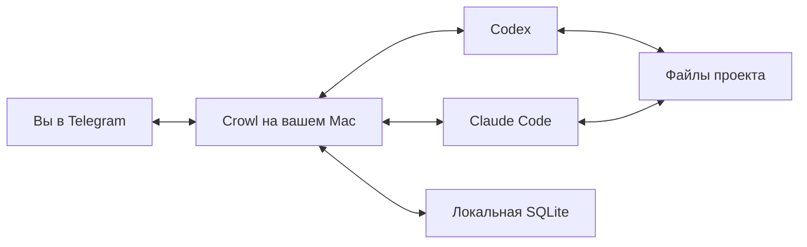

# Crowl

Telegram-интерфейс к локальным **Claude Code и Codex** на macOS. Отправляйте задачи текстом или голосом, следите за прогрессом и продолжайте сохранённые сессии с телефона. Агенты работают с файлами на вашем Mac.

Каждый проект получает собственную папку `.crowl`, Telegram-бота и историю сессий. Crowl запускается локально и не требует отдельного сервера или публичного HTTP-порта: сообщения поступают через Telegram long polling. Для постоянной работы подходит Mac Mini.

## Возможности

- Выбор Claude Code или Codex, отдельные сессии и продолжение их контекста после перезапуска.
- Текстовые задачи и локальная расшифровка голосовых сообщений через FFmpeg и whisper.cpp.
- Видимый прогресс, статус «печатает», сведения о модели, контексте и расходе токенов.
- Очередь задач, остановка выбранной сессии и режим подтверждения действий Ask.
- Хранение состояния в SQLite, резервные копии и восстановление доставки ответов.
- Фоновая работа через macOS LaunchAgent и независимые экземпляры для разных проектов.

Crowl написан на TypeScript и запускается непосредственно в Node.js 24. Runtime-зависимостей из npm нет; TypeScript и типы Node.js нужны для разработки и проверок.



## Подключение проекта

Нужны macOS, Git, **Node.js 24**, установленный и авторизованный Claude Code и/или Codex, токен бота от **@BotFather** и ваш числовой Telegram user ID. Для текста достаточно одного из агентов. Голосовой ввод настраивается отдельно.

```bash
cd /path/to/your/project
git clone https://github.com/misha-mg/crowl.git .crowl
cd .crowl
npm ci
cp .env.example .env
```

Заполните две строки в `.env`:

```dotenv
TELEGRAM_BOT_TOKEN=123456:your_bot_token
TELEGRAM_USER_ID=123456789
```

Создайте отдельного бота через `/newbot` у **@BotFather** для каждого проекта. User ID — числовой ID аккаунта владельца, не username и не ID самого бота. Если ID неизвестен, сначала заполните токен, отправьте своему боту `/start` и выполните `npm run telegram:id`, пока Crowl остановлен. Скопируйте полученный ID в `.env`. Токен храните только в локальной конфигурации.

```bash
npm run doctor
npm start
```

Откройте бота, отправьте `/start`, выберите Codex или Claude и напишите задачу. Пример: «Найди причину ошибки авторизации и исправь её». Агент запускается в родительской папке `.crowl`, независимо от директории терминала.

Код Crowl не нужно добавлять в `package.json` рабочего проекта. Если проект использует Git, команда `npm run setup:exclude` добавит `.crowl/` в его локальный `.git/info/exclude`.

## Сессии и управление

Над строкой ввода доступны три постоянные кнопки: **⏹ Стоп**, **ℹ️ Информация** и **⚙️ Опции**. Информация приходит одним сообщением: проект, текущая Git-ветка, агент, модель, расход токенов, контекст и состояние. Запрос сводки не отправляется модели и работает во время выполнения задачи.

«Опции» открывает сообщение с кнопками: новая сессия, закрытие, продолжение сохранённой сессии, переименование, чистый контекст, разрешения, очередь и справка. Для продолжения выберите сессию из списка. При переименовании следующее текстовое сообщение становится именем; есть кнопка отмены. Команды меню не отправляются агенту как промпты.

Usage и контекст берутся из событий новых запусков CLI и сохраняются отдельно по сессиям. Если показатель ещё не получен, отображается «нет данных». Контекст относится к последнему запросу модели; расход токенов не означает остаток лимита подписки. Reply-клавиатура запрашивается как постоянная, её отображением управляет Telegram-клиент.

| Команда | Действие |
| --- | --- |
| `/options` | Открыть меню опций |
| `/new` | Новая сессия с выбором агента |
| `/close` | Закрыть текущую сессию и снова выбрать Claude или Codex |
| `/sessions` | Список и выбор сохранённых сессий |
| `/rename название` | Переименовать текущую сессию |
| `/clear` | Пустой контекст того же агента; старая сессия остаётся |
| `/info`, `/status` | Проект, ветка, модель, usage, контекст и состояние |
| `/permissions` | Выбор Full или Ask |
| `/stop` | Прервать текущую задачу, поставить очередь на паузу |
| `/queue` | Продолжить или очистить ожидающую очередь |
| `/help` | Справка |

Можно создать новую сессию или переключиться через `/sessions`, пока предыдущая продолжает работать. По умолчанию `MAX_CONCURRENT_SESSIONS=1`: задачи разных сессий выполняются последовательно, чтобы агенты не меняли общие файлы одновременно. Переключение сессии сохраняет выполняющуюся задачу; новые задания ждут свободного места. Внутри каждой сессии — одна задача и своя FIFO-очередь. В списке `→` отмечает выбранную сессию, `▶` — работающую, `◷` — ожидающие задания. Смена провайдера создаёт отдельный контекст: история Claude не переносится в Codex автоматически.

Обычный текст и голос поступают в выбранную сессию. Reply на ответ или прогресс другой сессии продолжает именно её, не меняя выбранную. Ответы, вопросы и расшифровки привязаны к исходному сообщению задания. Неизвестный Reply не отправляется агенту наугад.

Параллельное выполнение включается явно через `MAX_CONCURRENT_SESSIONS=2..16`. Все сессии проекта используют общие файлы и Git index; Git worktree-изоляции в этой версии нет. При таком режиме нужно разнести задачи по файлам и согласовать Git-операции. `doctor` и запуск Crowl показывают выбранный лимит и предупреждают об общей папке. Существующее явное значение `4` в `.env` сохраняет параллельное выполнение после обновления.

«Стоп», `/queue` и `/close` относятся только к выбранной сессии. Остановка сохраняет её очередь на паузе; возврат к сессии с ожидающими задачами не запускает их без явного продолжения через `/queue`. При смене permissions сначала завершается или останавливается задача только этой сессии.

`/close` прерывает текущую работу, отменяет ожидающие задачи закрываемой сессии и показывает выбор агента. История сохраняется в `/sessions`; сессию можно открыть снова. Новая сессия после закрытия начинает работу без оставшейся паузы очереди.

По умолчанию запрошен полный доступ. В Ask запросы подтверждения приходят кнопками; свободные вопросы агента принимают **Reply на конкретное сообщение бота**. Обычное сообщение без Reply остаётся новым заданием. Изменение режима применяется и проверяется при следующем ходе. `/status` показывает последний ответ CLI, не обещает отмены системных правил macOS или управляемых политик агента.

Полный доступ не ограничен папкой проекта на уровне ОС. Crowl допускает только приватный чат числового владельца. Все экземпляры работают под вашим пользователем macOS.

## Голосовые сообщения

Текст работает без дополнительных компонентов. Для голоса один раз подготовьте локальные FFmpeg, whisper.cpp и многоязычную модель:

```bash
npm run voice:setup
npm run doctor
```

Установщик использует существующий Homebrew и скачивает модель `base` в `~/Library/Caches/crowl/ggml-base.bin`. Это общая модель для всех проектов. Если Homebrew отсутствует, команда покажет инструкцию. Нормальный запуск Crowl ничего не устанавливает и не скачивает модель скрыто.

Голос до 5 минут / 20 MB преобразуется из OGG/Opus в WAV и распознаётся локально. Расшифровка автоматически передаётся агенту и не публикуется отдельным сообщением. Распознавание, прогресс агента и итог сменяются в одном обычном сообщении без Telegram Reply к заданию. Пока идёт работа, бот обновляет статус «печатает»; ожидание ответа владельца этот статус не продлевает. Следующее текстовое сообщение не обгоняет голосовое. Временное аудио удаляется после обработки. Оригинальное сообщение проходит через Telegram, а распознанный текст — через выбранного агента.

Временный текст «Расшифровываю…» заменяется доступным прогрессом агента и затем ответом. Для Codex запрашиваются публичные reasoning summaries (`summary: auto`); пояснения, summary и действия инструментов приходят в то же сообщение. Статус «печатает» дополняет видимый прогресс. Сообщение прогресса отправляется без `reply_markup`, чтобы Telegram разрешал его редактировать; уже установленная постоянная клавиатура остаётся в чате. Для Claude явно включается `--thinking-display summarized` и отправляется управляющая команда `set_max_thinking_tokens` с `thinking_display: summarized` (без изменения бюджета), включая продолженные сессии; публичные thinking-summary из потоковых событий и готовых блоков отображаются в прогрессе. Подписи и зашифрованные/redacted-блоки не публикуются.

При нестандартной установке задайте `WHISPER_BIN`, `FFMPEG_BIN`, `WHISPER_MODEL_PATH`. Можно отключить голос через `VOICE_ENABLED=false`.

## Фоновая работа на Mac Mini

Сначала остановите foreground-процесс через Ctrl+C. Затем:

```bash
npm run service:install
npm run service:status
```

Устанавливается пользовательский LaunchAgent без sudo. Он работает после закрытия терминала, стартует при login пользователя и перезапускается после аварийного завершения. Автозапуск до login, включая разблокировку FileVault, сюда не входит.

```bash
npm run service:uninstall
```

Управление установленным сервисом: `npm run service:stop`, `npm run service:start`, `npm run service:restart`, `npm run service:status`. Повторная установка/запуск безопасны; состояние проверяется через launchctl. Подробности: [docs/SERVICE.md](docs/SERVICE.md).

Удаление сервиса сохраняет `.env` и `.data`. Каждый проект имеет свой service label. Не запускайте один токен одновременно в двух проектах: Crowl проверяет локальную блокировку бота и конфликт Telegram polling.

## Настройки и состояние

Дополнительные переменные перечислены в [.env.example](.env.example): провайдер по умолчанию, full/ask, абсолютные пути к CLI и STT. Для запуска из launchd не нужен interactive shell. При смене установки Node.js или переносе проекта переустановите LaunchAgent.

История, задания и результаты находятся в `.crowl/.data/crowl.sqlite`; нативные сессии агентов также используют их штатные локальные хранилища. Не переносите `.data` в другой проект. Новую копию Crowl создавайте без `.env` и `.data`. Переписка старой Telegram-сессии остаётся в чате, `/clear` её не удаляет.

Исходные payload обработанных Telegram updates и уже отправленные копии ответов очищаются через 30 дней, небольшими порциями при запуске и затем ежечасно. Сессии, задания, результаты и привязки Reply сохраняются. Для обработанных updates остаются идентификаторы, предотвращающие повторное выполнение. Неотправленные ответы с ошибкой автоматически не удаляются.

Crowl исключает секреты и состояние из собственного Git. Для локального исключения всей `.crowl` из родительского Git-проекта:

```bash
npm run setup:exclude
```

Технические логи с ротацией: `.data/events.log`. Логи сервиса: `.data/service.log`, `.data/service-error.log`. Crowl не пишет в технический лог полные промпты, токены и сырой вывод инструментов. Сама SQLite содержит историю сообщений и результатов.

Если Crowl аварийно перезапустился во время работы, результат может быть `unknown`: проверьте изменения файлов, затем выберите действие в `/queue`. Crowl не повторяет такую задачу автоматически. Остановка не откатывает уже сделанные изменения. При сетевом сбое возможен повтор итогового Telegram-ответа, но не автоматический повтор задания.

Постоянная ошибка доставки отдельного ответа не блокирует следующие сообщения. Текст и причина сохраняются в БД; временные ошибки повторяются с задержкой, после 12 неудач без учёта Telegram rate limit ответ переводится в недоставленные. Посмотреть состояние и повторить только отправку можно из `.crowl`:

```bash
npm run outbox:status
npm run outbox:retry -- 42
# Повторить все недоставленные ответы:
npm run outbox:retry -- all
```

Повторная отправка не запускает задачу агента. Закрытые вопросы и разрешения не возвращаются в доставку. После устранения причины ошибки Crowl отправит возвращённые в очередь ответы при следующем запуске либо в уже работающем процессе.

Обновление: `npm run service:stop` (для foreground — Ctrl+C) → `npm run backup` → обновить исходники → `npm ci` → `npm run check` → `npm run doctor` → `npm run service:start`. Команда backup также работает online, открывает БД только для чтения и не мигрирует её перед сохранением. Перед обновлением существующей БД до схемы 5 Crowl дополнительно создаёт `.data/before-migration-v*.sqlite`; изменения схемы и данных выполняются одной транзакцией. Резервные копии сохраняются в `.data`.

`npm run app:version` и `doctor` показывают версию пакета и fingerprint исходников. Та же пара записывается при запуске в консоль и `events.log`. Она позволяет отличить проверенный checkout от установленной копии `.crowl`; fingerprint не включает `.env`, историю и зависимости. Чтобы применить новые исходники, перезапустите соответствующий экземпляр.

## Проверки

```bash
npm run check
npm test
npm run probe
# Явные реальные запросы к модели, с использованием локального аккаунта:
npm run smoke -- claude
npm run smoke -- codex
```

`probe` проверяет локальный протокол и режимы, не отправляя задачу модели. `smoke` использует временную папку, проверяет изменение файла и продолжение контекста в новом процессе; может расходовать лимит/средства вашего аккаунта. Автотесты не используют реальные аккаунты или Telegram-токены.

Текущий статус реальных проверок и пункты совместной приёмки: [VERIFICATION.md](VERIFICATION.md). Архитектурные решения и отклонения от исходного плана: [docs/ADR-001.md](docs/ADR-001.md). Требования: [PRD.md](PRD.md).

## Второй проект

```bash
npm run project:add -- /absolute/path/to/second-project
```

Установщик добавляет чистую `.crowl` с пустым `.env`, не перезаписывает существующий экземпляр и не переносит токены или историю. Для второго проекта нужен отдельный бот. Подробности: [docs/PROJECTS.md](docs/PROJECTS.md).

Настройка и ограничения настоящего голосового ввода: [docs/VOICE.md](docs/VOICE.md). Архитектура одновременных сессий: [docs/ADR-002.md](docs/ADR-002.md).

## Разработка

Для работы над самим Crowl клонируйте его в отдельную директорию:

```bash
git clone https://github.com/misha-mg/crowl.git
cd crowl
npm ci
npm run check
npm test
```

| Путь | Назначение |
| --- | --- |
| `src/main.ts`, `src/runtime.ts` | Запуск, Telegram polling и доставка ответов |
| `src/core.ts`, `src/scheduler.ts` | Сессии, очередь и выполнение задач |
| `src/providers/` | Адаптеры Codex и Claude Code, обмен с дочерними процессами |
| `src/storage.ts`, `src/migrations.ts` | SQLite, миграции и сохранённое состояние |
| `src/voice.ts`, `src/service.ts` | Голосовой ввод и macOS LaunchAgent |
| `scripts/` | Установка в проект, диагностика и smoke-проверки |
| `tests/` | Автоматические проверки с временными проектами и тестовыми агентами |
| `docs/` | Эксплуатация и архитектурные решения |

GitHub Actions запускает TypeScript-проверку и тесты на macOS с Node.js 24. Реальные Telegram-токены и аккаунты агентов для CI не нужны.

Crowl находится на ранней стадии разработки. Поддерживаемая среда — macOS и один владелец бота; совместимость с новыми версиями CLI проверяйте через `npm run probe`. Перед отправкой изменения выполните `npm run check` и `npm test`; для ошибок укажите версию Node.js, версию CLI и вывод `npm run app:version` без содержимого `.env` и истории чата.
